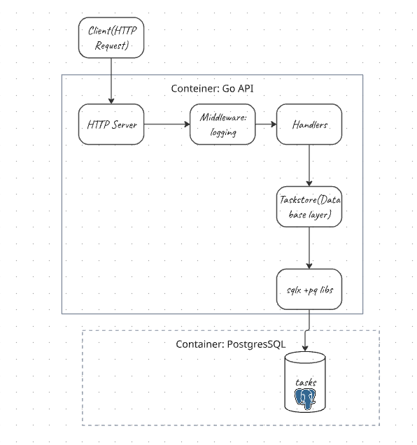

# REST API ToDoList

Простой REST API сервис которые выполняет CRUD-операции соответствующие ToDoList-у с бэкендом на языке Go и работающий в Docker-контейнере вместе с базой данных Postgres.

# Архитектура проекта.

## Схема:
